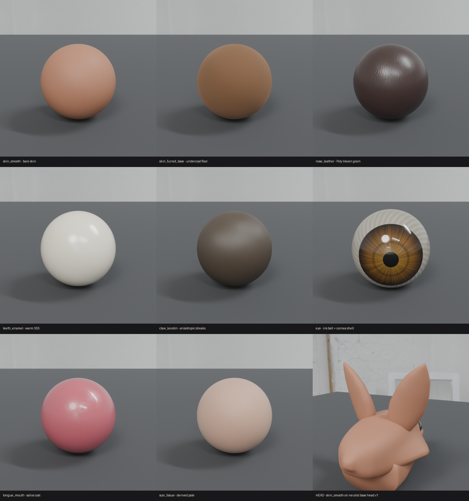

# AnthroForge Materials Lab

*Built Nov 12, 2026. Companion data: [materials.json](materials.json) — the swatch renderer
([scripts/render_swatches.py](scripts/render_swatches.py)) builds its Blender materials
directly from that file, so the JSON is the single source of truth and the renders are proof
it parses into something physical.*

Individual frames in [renders/](renders/) · scene preserved as
[swatch_scene.blend](swatch_scene.blend) · iris texture by
[scripts/gen_iris.py](scripts/gen_iris.py) · sheet stitched by
[scripts/make_contact_sheet.py](scripts/make_contact_sheet.py).

---

## 1. The material record format (`anthroforge.materials`, v1)

A character file never stores shader graphs. It stores, per body region, a **material id +
instance overrides** (tint within the record's colour range, variant flags like nose
coat 0 = dry). The library record itself is engine-neutral PBR:

| Field | Meaning |
|---|---|
| `id`, `display_name`, `category` | Stable id (snake_case); categories: skin, keratin_surface, hard_tissue, mucosa, composite, skin_variant |
| `intended_parts` | Where the record is meant to ride |
| `pbr.base_color` | sRGB hex `srgb_low / srgb_default / srgb_high` — the legitimate variation band (individual, species, age), *not* a gradient. One record may instead carry a `rule` (see scar) |
| `pbr.roughness` | `{low, default, high}` in glTF convention |
| `pbr.subsurface` | `weight` + `radius_rgb` (relative chromatic profile) + `scale_mm` (physical mean-free-path scale — converted to scene units on import) |
| `pbr.coat` | Clearcoat-equivalent weight/roughness. Always a literal film: saliva, tear film, nose moisture. Never a stylistic gloss |
| `pbr.sheen` | Retroreflective fuzz term; for furred surfaces the sheen colour is the coat's *highlight* tint |
| `pbr.anisotropy`, `pbr.ior`, `pbr.specular_level`, `pbr.metallic` | Metallic is 0 across the whole set — no living tissue is metallic |
| `normal` | `{source: "texture", path}` (OpenGL convention) **or** `{source: "procedural", recipe}` — procedural entries name the generator to implement, keeping records portable before textures exist |
| `layers` | Composite records only: sub-records rendered as separate shells (eye = iris ball + cornea shell) |
| `gltf_export` | Per-record honesty note: what survives export and what is lost |
| `justification` | Why these numbers — the real-world analogue, in the record itself |

**Export reality (applies to the whole set):** core PBR always survives glTF. SSS has no
core glTF term (KHR_materials_volume approximates it; most web viewers drop it), sheen →
KHR_materials_sheen, coat → KHR_materials_clearcoat, transmission →
KHR_materials_transmission, anisotropy → KHR_materials_anisotropy. Consequence already
encoded in the app design: final/hero renders happen in Blender, glTF is the interchange
and game tier. Mouth interiors and teeth lose the most in plain viewers.

## 2. Texture inventory — what is actually on disk

### 2.1 Poly Haven haul (Nov 6, all CC0 — build-tier clean)
`~/workspace/bodies-3d/parts-library/polyhaven/`

| Asset | Files | Used by |
|---|---|---|
| **Photo Studio 01 HDRI** (`photo-studio-01-hdri/photo_studio_01_2k.hdr`) | 2k .hdr + LICENSE.txt (CC0) | Lighting for every swatch render in this lab |
| **Brown Leather PBR set** (`brown-leather/`) | Diffuse, Rough, AO, Displacement, Normal DX + **Normal GL**, all 2k | `nose_leather` normal + roughness (stand-in grain — see §3.3) |
| **Lion head scan** (`lion-head/`) | glTF + `textures/` diff/arm/nor_gl 1k | Reference skin/fur colour behaviour; the scan's own PBR set |

A working duplicate of the leather set also lives in
`~/workspace/bodies-3d/kaleaon-realism/textures/` — same files; the parts-library copy is
canonical.

### 2.2 Texture sets riding with library models
| Source | Textures | Notes |
|---|---|---|
| Golden retriever (CC BY), `parts-library/existing-haul/golden-retriever-ccby/textures/` | baseColor, emissive, metallicRoughness, normal | Full PBR set for a realistic canid coat — best on-disk reference for fur colour breakup |
| Wolf rigged (CC BY), `parts-library/existing-haul/wolf-rigged-ccby/textures/` | baseColor only | Coat albedo reference |
| Cougar (GalileoGB), `parts-library/sketchfab/cougar-galileogb/textures/` | `T_CougarFemale.png`, `T_Mouth_Cat.png`, eye textures (`T_MitaEye_Round1.png`, `T_Eye_SmallNewest_Normal.png`, shine) | Mouth-interior colour layout + iris layout references, cited in `tongue_mouth` and `eye` records |
| Terris/Taryk/Oracle/Orca (GalileoGB), `parts-library/sketchfab/*-galileogb/textures/` | per-model sets | Coat albedo references |
| Base head v1 GLB (`anthroforge-v2/base-head/neutral_base_head.glb`) | **none embedded** (2 untextured materials) | Why the head tile in the sheet is a pure material demo |

### 2.3 NOT on disk — pending the SL wear-scan
The Nov 12 Marketplace passes claimed texture packs into Kaleaon's SL inventory, including
the **"Fur (1)" 6 seamless fur textures**, the basic hair texture pack (40 textures), and
full-perm eye packs. Those files exist **only inside SL inventory** — per the grabber
findings, inventory asset UUIDs for objects are withheld by the grid, so they cannot be
pulled over HTTP from this VM. They land on disk only when the wear-scan loop runs
(wear → Firestorm export on Joe's Windows machine, per `~/workspace/sl-client/WEAR_SCAN_QUEUE.md`).
Until then: **there is no real fur texture on disk**, and `skin_furred_base` is deliberately
only the *floor* under a fur system, not a fur material. (See §4.)

## 3. The eight starter materials — per-material notes

Swatches are 12 cm spheres, Cycles, 28 samples + denoise, Photo Studio 01 HDRI + one sun.
Swatch scale matters: subsurface `scale_mm` is applied *physically*, so a 12 cm sphere
shows SSS the way a real nose/ear of that size would — the ear rims in the head tile glow
for the same reason real ears do.

### 3.1 `skin_smooth` — bare skin
Warm mid-brown, roughness 0.55, SSS 0.35 with the red-weighted profile
(1.0 / 0.42 / 0.26, 3 mm). Reads correctly in the swatch: soft terminator, faint pore bump.
This is the muzzle/inner-ear/eyelid default. Colour band #6e4630–#dfae8d spans melanin
variation; species tint multiplies from the default #a9745a.

### 3.2 `skin_furred_base` — undercoat floor
Roughness 0.88, sheen 0.6 with the sheen *tint* driven to a lightened coat colour (never
white). The swatch is intentionally quiet — darker and flatter than skin_smooth. That is
the record working as designed: light that enters a coat mostly doesn't come back. If a
future fur system makes this layer invisible, fine; where cards thin out, this is what
keeps the body from looking hollow.

### 3.3 `nose_leather` — the one fully texture-backed record
Near-black brown (#3a2a26), roughness driven by the actual Poly Haven leather roughness
map re-ranged to 0.25–0.42, normal from the leather GL normal at 0.6, coat 0.25 = the wet
nose. The swatch is the strongest of the eight — visible grain, wet highlight pool.
Honest caveat, also in the record: leather grain is a *stand-in*. Real rhinarium has a
polygonal crackle pattern (individual-unique, like a fingerprint). A dedicated crackle
normal is an authoring task, not a download we have.

### 3.4 `teeth_enamel`
Ivory #e9e1cd, roughness 0.22, the warmest SSS profile in the set
(1.0 / 0.72 / 0.45 — dentine showing through enamel), measured enamel IOR 1.63, light
saliva coat. The swatch shows the warm cream falloff at the terminator that separates
"tooth" from "white plastic". One record for the whole universal arcade: diet morphs
reshape teeth; they don't change what teeth are made of.

### 3.5 `claw_keratin`
Satin grey-brown, roughness 0.45, anisotropy 0.45 + longitudinal streak bump. On a sphere
the anisotropy is subtle (it needs an elongated form to run along); expect it to read
properly on claw/horn geometry. Keratin IOR 1.55. Colour band runs near-black horn to
pale claw — at the pale end SSS 0.2 is load-bearing against a plastic read.

### 3.6 `eye` — composite: iris ball + cornea shell
Two layers, two meshes. Iris ball: generated amber iris texture
([textures/iris_amber.png](textures/iris_amber.png) — radial fibres, collarette ring, dark
limbal ring, ~85% iris coverage since most anthro mammals show almost no sclera), coat 0.6.
Cornea shell at 1.045× radius: transmission 1.0, IOR 1.376 (measured), roughness 0.04.
The swatch shows exactly the effect the split exists for: a broad softbox reflection on the
shell *plus* a sharper highlight inside the iris — a single glossy sphere never stacks
those. Pupil size/shape is a texture parameter (round / vertical slit / horizontal
families), not geometry. Cougar eye textures in §2.2 are the layout reference for
production iris textures.

### 3.7 `tongue_mouth`
The reddest, strongest SSS in the set (0.6, profile 1.0 / 0.32 / 0.24, 3.5 mm) under a
permanent saliva coat (0.45 @ roughness 0.12) and papillae stipple. The swatch highlight
shows the stipple breaking the coat gloss — the difference between a tongue and a pink
balloon. The record carries a standing warning: never ship a mouth interior with coat 0.
Blue-black (chow-type) tongues are a species variant record, not a range end.

### 3.8 `scar_tissue`
Defined by a **derivation rule**, not just a colour: host skin colour, lightness +~15%,
saturation −~35%; exemplar on default skin = #c39a83. Roughness 0.38 — *below* skin,
because scar collagen is tighter and follicle-free; SSS drops to 0.15 (fewer vessels);
aligned-streak normal; +0.5–1.5 mm displacement (hypertrophic default, sign-flippable per
instance for atrophic scars). A scar must read as a variant of *this* character's skin on
any species tint — the rule is the material. `scar_fresh` (red/purple, SSS restored) is a
named future variant, deliberately not in v1.

## 4. Blockers & next steps

1. **Fur textures are blocked on the SL wear-scan.** The claimed SL fur/hair texture packs
   are the only real fur textures in the collection, and they are inventory-locked until
   the wear→export loop runs on the Windows machine. Until then there is no honest
   `fur_coat` record — `skin_furred_base` + the strand/card system (fur prototype) carry
   the coat, and any "fur texture" invented procedurally would be a guess, which this
   project's rules don't ship.
2. **Nose crackle normal** — author a dedicated rhinarium crackle normal to retire the
   leather stand-in.
3. **Production iris textures** — the generator proves layout; per-character irises want a
   proper radial-fibre bake at 1k+ with the three pupil families.
4. **Wet/dry states** are already parameterised (coat weights) but want named state
   presets in the app (awake/asleep nose, dry/wet mouth) rather than raw numbers.

## 5. Method notes (so the renders are reproducible)

- Engine is **Cycles**, not Eevee: Eevee aborts headless on this VM (no libEGL) — Cycles
  is the established route in this workspace (base-head builds use it too).
- `scripts/render_swatches.py` reads `materials.json` and builds every Principled node
  from the records (Blender 5.2 field notes: sheen colour input is `Sheen Tint` in this
  build). Re-running it re-renders any missing swatch and skips existing ones.
- Render contention note: the swarm had up to four Blender jobs sharing 1.5 CPUs during
  this run; timings (~2–5 min/frame) are contention artefacts, not pipeline cost.
