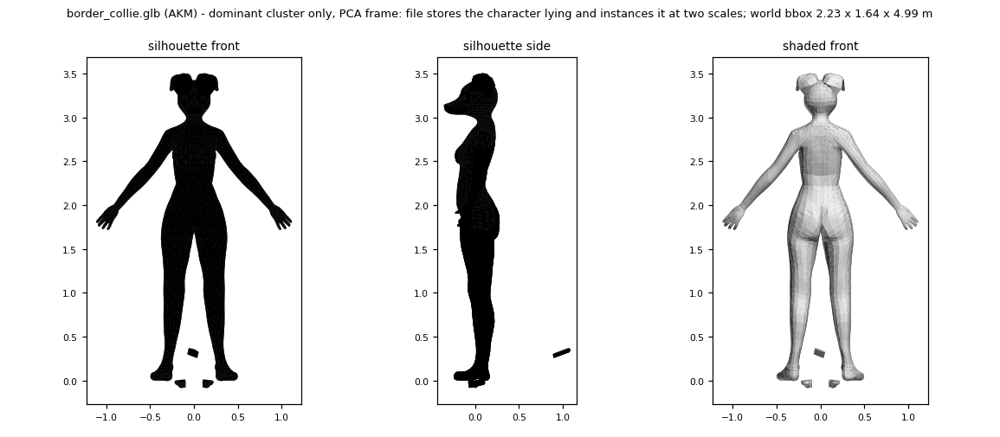
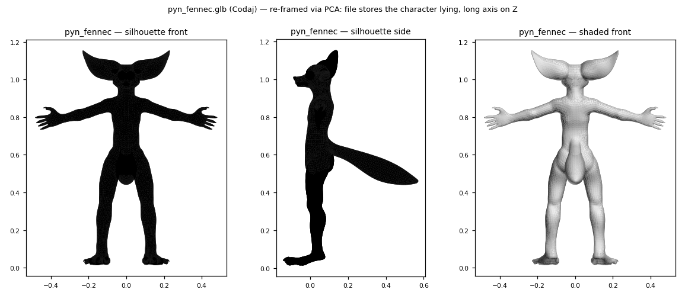
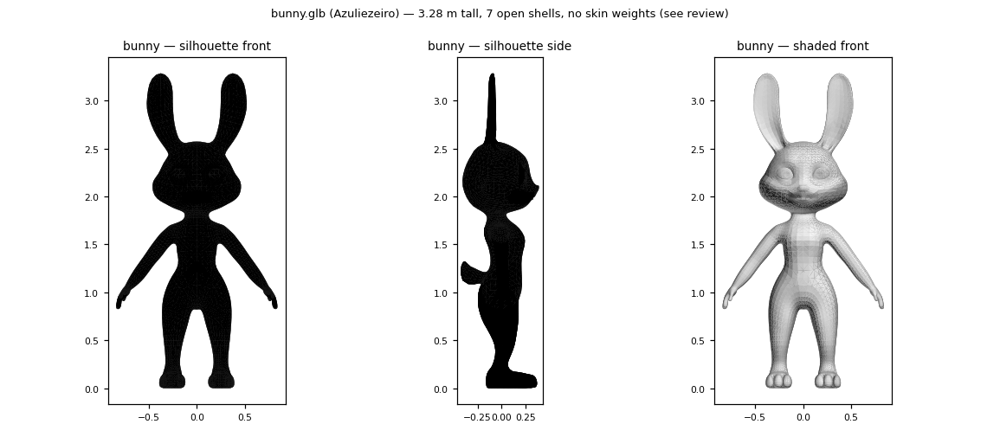

# Applied Reviews — B20 first pass (Nov 12, 2026)

Three library models reviewed under [`CRITIQUE.md`](CRITIQUE.md), chosen
from the QA-gauntlet sweep to span the library's range: its gold
reference (strong), our own primary character rig (mid), and one of its
two skin-class failures (weak). Panels are ortho projections of the real
GLB triangles in each character's anatomical frame (matplotlib; this VM
has no Blender binary — panels are evidence, not beauty renders).

---

## Review 1 — border_collie.glb (AKM) · STRONG

Gate-0 line: 8,757 verts · 14,627 tris · 66 joints · 12 morphs ·
7/7 textures embedded · 0 degenerate · 0 NaN · scale flag: none (but
see Proportion).
Panel: 
Inspector key numbers: weights sums exactly [1.000, 1.000] on all 9
weighted shells · 0% unweighted · max 4 influences · non-manifold 0 ·
bad-winding 0 · boundary edges 2,735 (12 shells) · poles (valence ≥7)
23.3% · valence-3 11.2% · mean valence 5.32 · morph accessor bounds
133.9–150.0 units, identical across each shell's targets · animation:
1 clip, 62 channels, 8.3 s.

| Category | Score | Evidence |
|---|---|---|
| Silhouette | 4/5 | Instant collie read in its frame: folded collie ears, long muzzle in profile, digitigrade leg break, A-pose with clean arm separation. Docked: as stored, the file loads *lying* (long axis on Z) amid prop shells — the first read in a naive viewer is a floor plan, not a character. |
| Proportion | 4/5 | Skeleton landmarks land: pelvis 0.786 (59.7% of head-joint height), wrist 0.759 ≈ pelvis height (−2.7 cm), head 1.317. Docked: the character is **instanced at two scales** in one file (dominant cluster ≈3.6 units tall; a second copy ≈1.35) and the world bbox is 2.23 × 1.64 × 4.99 m — "the model's size" is not a single fact until the file is cleaned. |
| Anatomy | 4/5 | Shaded panel: bust, abdomen, glute and thigh volumes placed plausibly over the implied skeleton; muzzle has length and a stop; secondary form present but soft (muscle groups implied rather than modelled) — right for this style. |
| Topology | 3/5 | Manifold and correctly wound everywhere, but the triangulated proxies are the least even of the three models reviewed: 23.3% poles and 11.2% valence-3 verts point at dense, irregular patches (face/accessory shells). Multi-shell construction (12) is legitimate; shell hygiene is not the issue — density placement is. |
| UV & Textures | 4/5 | All 9 character shells UV'd; 7 textures, all embedded; 12 materials. Docked: 3 micro shells (56/48/4 verts) are un-UV'd, unweighted helper/prop geometry shipped inside a character file. |
| Deformation | 4/5 | The best *honest* deformation data in this set: perfectly normalized weights, full finger chains, ear base/tip joints, an 8.3 s animation, and the export-prototype already proved its weights/morphs survive DAE/FBX round-trips. Docked: **the 12 morph targets are stored as absolute positions in a ~134–150-unit source frame** (accessor bounds identical across targets, ~100× the mesh's world scale) — applied as glTF deltas at face value they would destroy the mesh; they must be unit-normalized on import. |

**Total: 23/30 — Verdict: Adopt with fixes** (the library's current
reference standard once the import normalization below is applied).
Weakest: Topology 3.

### Fix list
- [major] Deformation — morph targets stored as absolute positions in
  source units (bounds 133.9–150.0, identical per shell) → convert to
  true deltas against base positions at import; add a gauntlet check
  for "target bounds ≈ mesh extent ⇒ absolute storage". Effort: M
- [major] Proportion — character instanced at two scales; world bbox
  4.99 m → keep the correctly-scaled instance, delete or namespace the
  other; re-export standing (Y-up, long axis vertical). Effort: M
- [minor] UV & Textures — 3 un-UV'd/unweighted prop shells inside the
  character file → strip or move to a props file. Effort: S
- [minor] Topology — pole-heavy patches (23.3% valence ≥7) → note for
  any future retopo; not worth touching while deformation data is this
  clean. Effort: L (deferred)

---

## Review 2 — pyn_fennec.glb (Codaj) · MID

Gate-0 line: 41,304 verts · 78,860 tris · 107 joints · 0 morphs ·
0 textures · 0 animations · 0 degenerate · 0 NaN · single primitive.
Panel: 
Inspector key numbers: weights sums exactly [1.000, 1.000] · 0%
unweighted · max 4 influences · non-manifold 0 · bad-winding 0 ·
boundary edges 3,608 in the *single* shell · poles 11.4% ·
valence-3 2.1% · mean valence 5.82 · UV extent 0.62 × 1.00, 0%
collapsed, median density 0.321 UV/m² · mesh bbox 0.966 × 0.692 ×
1.152 m (long axis on Z — stored lying).

| Category | Score | Evidence |
|---|---|---|
| Silhouette | 4/5 | The best silhouette of the three *in its frame*: instant fennec — ear span ≈ half of height, tail ≈ 45% of height, digitigrade profile, clean T-pose, nothing merges. Docked for the stored orientation: it loads lying down, long axis on Z. |
| Proportion | 4/5 | Deliberate, internally consistent stylisation: pelvis at 50.9% of skeleton extent (1.102), spine (hips→neck) 31.5%, legs ≈43%, head+ear-base reaching 95% before the ear chains even start. Ratios serve the character (Pyn) exactly as designed. |
| Anatomy | 3/5 | One continuous, smooth surface; muzzle, eye ridges, chest and genital forms modelled; but at 41k verts the anatomy is *implied* — limbs are near-tubes with knee/ankle hints, muscle groups are not built, face structure beyond muzzle/eyes is thin. Density is spent uniformly instead of on face and hands, where a fennec reads. |
| Topology | 3/5 | Cleaner distribution than the collie (poles 11.4%, mean valence 5.82, zero manifold/winding defects) — but 3,608 boundary edges in a *single* shell means the "one body" is an open surface (mouth/eye/ear openings plus seam splits) and 78,860 tris is heavy for an untextured stylised base whose detail level doesn't need it. |
| UV & Textures | 2/5 | A real UV layout exists (0% collapsed) but uses only ~62% of U space, and the file ships **zero textures** — the layout is unproven: nothing has ever been painted on it in this copy. Under the rubric, untextured caps at 3; the wasted third of the sheet costs the third point. |
| Deformation | 4/5 | Richest rig of the three: 107 joints — 4-deep ear chains, eye joints, full fingers, a toe chain — with perfectly normalized weights, and *proven*: the retarget prototype moved 6 actions onto it and the toe chain animates. Docked: **0 morph targets** in this copy (no visemes/expressions despite the eye/ear joints begging for them), 0 shipped animations, and name hygiene defects — mojibake joint names (`�ebro_L_04`), a typo (`Shouder_L_020`), duplicate eye joints (`Eye_L_013` *and* `LeftEye_018`), a numbering break (`Eye_R_00`). Names are an API; three of its names are broken. |

**Total: 20/30 — Verdict: Usable — work order required.** It is the
library's deformation reference (the rig our retargeting already runs
on); it is not a finished character asset. Weakest: UV & Textures 2.

### Fix list
- [major] UV & Textures — no textures ship and 38% of U is empty →
  repack the layout to full sheet and ship at least a base-colour pass
  so the UVs are proven. Effort: M
- [major] Deformation — 0 morph targets on a rig with eye/ear joints →
  author the viseme/expression set this copy is missing (the species
  spec's expression system names the targets). Effort: L
- [major] Silhouette — stored lying (long axis Z) → re-export standing
  in the character's frame; keep the lying original archived. Effort: S
- [minor] Deformation — joint-name defects (mojibake ×2, `Shouder`
  typo, duplicate eye joints, `Eye_R_00`) → rename map at import; fix
  at source on the next export. Effort: S
- [minor] Anatomy/Topology — 78.9k tris, uniform density → decimate
  the low-detail regions (limbs, back) if this becomes a shipping
  base; keep face/hands density. Effort: M

---

## Review 3 — bunny.glb (Azuliezeiro) · WEAK

Gate-0 line: 11,900 verts · 19,980 tris · **skin present, 1 joint
(`metarig_rootJoint`), 0 weighted primitives → GATE-0 SKIN FAILURE** ·
0 morphs · 0 textures · 0 animations · 0 degenerate · 0 NaN.
Panel: 
Inspector key numbers: no WEIGHTS_0 on any of 7 shells · non-manifold
0 · bad-winding 0 · boundary edges 3,744 · poles 6.1% · valence-3
2.8% · mean valence 5.35 · UV median density spread 0.043–10.46 UV/m²
across shells (~240×) · one shell with 11.36% zero-area UV tris ·
bbox 1.682 × 3.284 × 0.813 m.

| Category | Score | Evidence |
|---|---|---|
| Silhouette | 3/5 | Front view reads instantly as a bunny (ears = 22% of height, chibi head). Side view lets it down: the head is a near-perfect sphere, both ears merge into a single blade, and the muzzle barely breaks the outline — the profile is a lollipop, not a lagomorph. |
| Proportion | 3/5 | The chibi intent is internally coherent (head+ears ≈ 42% of height, by design for the style), but the file's scale is a defect: **3.28 m tall** with no note — it imports as a giant. Front silhouette also shows the legs reading as one fused mass (inner-leg separation is weak at the hips). |
| Anatomy | 2/5 | Blobby throughout: eye ridges and a muzzle hint on the face, toe beans on the feet, and nothing else — no muscle or landmark structure anywhere, no neck (head sits directly on torso), hands are grooved mittens. Acceptable starting point for the style; it is a mannequin, not a body. |
| Topology | 3/5 | The irony of this set: its raw distribution is the *cleanest* (poles 6.1%, mean valence 5.35, zero manifold/winding defects). But it's 7 open shells, and the body shell spends 8,744 verts / 15,196 tris on a smooth low-detail form — density with nothing to describe. Clean wiring, wasted budget, and no deformation loops to judge because nothing deforms. |
| UV & Textures | 2/5 | All shells are UV'd, and that's where the good news ends: texel density varies ~240× shell-to-shell (0.043 vs 10.46 UV/m²), several shells are squeezed into thin strips (1.0 × 0.07–0.15 of the sheet), one shell has **11.36% collapsed UV triangles** (a permanent texture smear), and zero textures ship to prove any of it. |
| Deformation | 0/5 | **The disqualifier.** The file declares a skin — with inverse bind matrices — containing exactly one joint and zero weighted vertices. It advertises a rig that does not exist; the QA gauntlet's only skin-class failure mode in the library, shared with its sibling fox_fem file. Any tool that trusts the skin block breaks. No morphs, no animations. |

**Total: 13/30 — Verdict: Static/reference only** (band *and* the
Deformation-0 cap agree). Usable as a sculpt silhouette reference or a
retopo source — never as a character base. Weakest: Deformation 0.

### Fix list
- [blocker] Deformation — vestigial skin (1 joint, 0 weights) → strip
  the skin block on import so nothing downstream trusts it; if the
  bunny is ever wanted as a character, it needs a from-scratch rig
  (or the B+ auto-skinning pipeline) — that is a new asset, not a fix.
  Effort: S (strip) / L (rig)
- [major] Proportion — 3.28 m tall → rescale to intended height at
  import and record the intended height in the library manifest.
  Effort: S
- [major] UV & Textures — ~240× texel-density spread + 11.36%
  collapsed UVs on one shell → re-unwrap to a single consistent
  density before any texture work is attempted. Effort: M
- [minor] Anatomy — legs read fused from the front → if retopo'd,
  deepen the inner-leg separation. Effort: M (only with the retopo)

---

## Cross-review findings (for the library, not one model)

1. **Sketchfab exports store characters lying down** (collie and
   fennec both, long axis on Z). Any importer, thumbnailer, or reviewer
   that trusts the stored frame will misjudge these files. The library
   needs a standing re-frame step at intake — and reviewers must score
   in the anatomical frame, as done here.
2. **"Has a skin" means nothing; "has weights" means everything.** The
   library's only two skin-class gauntlet failures are also its most
   dangerous files, precisely because they *look* rigged in a file
   listing. Gate 0 exists because of them.
3. **Morph storage is not standardized in the wild**: the collie's
   targets are absolute positions in source units. Delta-vs-absolute
   detection (target bounds ≈ mesh extent) belongs in the gauntlet.
4. **Untextured-with-UVs is the library's most common quiet state**
   (fennec, bunny, and most of the sweep). The rubric's cap-at-3 rule
   keeps "has UVs" from masquerading as "is textured".
5. **The strongest model here still needed 2 major fixes.** That is
   the rubric working as intended: 23/30 with a work order beats an
   unexamined "gold reference" label.

## Re-review log

- (open) Collie: after morph normalization + de-instancing — re-score
  Proportion, Deformation.
- (open) Fennec: after texture pass + name cleanup — re-score UV &
  Textures, Deformation.
- (open) Bunny: strip-skin is an import action, not a re-review item;
  re-review only if a rig is ever built.
